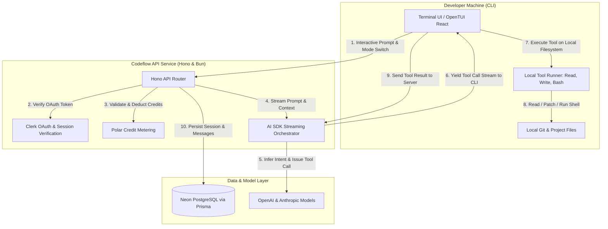

<div align="center">

# GNTI | Codeflow

<p><strong>Terminal-Based AI Coding Agent with Plan/Build Modes, Persistent Sessions & Local Tool Calling</strong></p>

<p>A flagship production foundation engineered by <a href="https://gnti.tech">Galaxy Nova Technologies & Innovations (GNTI)</a>.</p>

<p>
  <a href="https://gnti.tech"></a>&nbsp;
  <a href="https://github.com/GNTI-X/codeflow"></a>&nbsp;
  <a href="./LICENSE"></a>&nbsp;
  <a href="https://gnti.tech/projects/codeflow"></a>
</p>

</div>

---

## 📌 1. System Overview

**Codeflow** is an autonomous, terminal-first AI coding agent engineered to inspect, plan, and implement code directly within local developer repositories. Built for high-speed terminal interactions using Bun and OpenTUI (React-based terminal rendering), Codeflow enables developers to converse with state-of-the-art LLMs while maintaining strict safety boundaries through dual operational modes:

- **Plan Mode (Read-Only)**: Safely inspect files, search directories, and generate architecture blueprints without mutating local code.
- **Build Mode (Autonomous Execution)**: Empowers the agent to edit files, create new assets, and execute shell commands and test suites directly on the host machine.

The architecture decouples the lightweight terminal client from an extensible Hono API server, Postgres persistence on Neon, and a metered credit gateway managed through Polar.

---

## 🏛 2. Architecture & Monorepo Structure

### Monorepo Topology
```
codeflow/
├── packages/
│   ├── cli/        # Terminal client (Bun + OpenTUI / React)
│   ├── server/     # Central API server (Hono, AI SDK streaming, auth)
│   ├── database/   # Prisma ORM & PostgreSQL schema (Neon)
│   └── shared/     # Unified types, tool interfaces, & validation schemas
```

### System Architecture Diagram



### End-to-End Execution Flow

1. **Terminal Startup & Authentication**:
   - Developer executes `codeflow` in any project folder.
   - The CLI initiates a browser-based OAuth flow against Clerk, storing a local session token.
2. **Session Creation & Model Routing**:
   - User inputs a prompt and selects a model (e.g. Claude 3.5 Sonnet or GPT-4o).
   - The Hono server validates credit balance with Polar and initializes an active session in Postgres.
3. **Dual-Mode Safety Loop**:
   - In **Plan Mode**, tool declarations are restricted to read-only capabilities (`readFile`, `listFiles`, `searchCodebase`).
   - In **Build Mode**, full mutating capabilities are exposed (`writeFile`, `patchFile`, `runCommand`).
4. **Streaming & Client-Side Execution**:
   - As the LLM calls tools, the server streams the tool request to the CLI.
   - The CLI executes the tool on the local filesystem and streams output back to the server, continuing the reasoning loop until the task completes.

---

## 🛠 3. Categorized Tech Stack

| Domain | Technology | Purpose |
|:---|:---|:---|
| **Runtime & Engine** | `Bun` (>= 1.1) | Ultra-fast JavaScript/TypeScript runtime for both CLI and API server |
| **Terminal Interface** | `OpenTUI` & `React` | Rich terminal UI with interactive menus, spinners, status bars, and markdown |
| **API Framework** | `Hono` | Lightweight, edge-ready HTTP and SSE streaming framework |
| **Database & ORM** | `PostgreSQL` (Neon) via `Prisma` | Persisting developer sessions, message histories, and credit logs |
| **Authentication** | `Clerk` | Browser-based device authorization and user identity management |
| **AI Integration** | `Vercel AI SDK` | Multi-model routing (Anthropic, OpenAI, Google) and streaming tool calling |
| **Billing & Credits** | `Polar SDK` | Usage metering, subscription management, and credit pack billing |

---

## 🗄 4. Domain Data Model & Entity Relationships

- **`Session`**:
  - `id`: CUID Primary Key
  - `userId`: Clerk User ID (indexed)
  - `title`: Auto-generated session name
  - `messages`: JSON-encoded structured conversation history (roles, tool calls, tool results)
  - `createdAt`, `updatedAt`: Timestamps

---

## 🔑 5. Environment Variables Reference

| Variable | Required | Description |
|:---|:---:|:---|
| `DATABASE_URL` | **Yes** | PostgreSQL connection string (Neon pooler supported) |
| `CLERK_SECRET_KEY` | **Yes** | Clerk private API key |
| `CLERK_PUBLISHABLE_KEY` | **Yes** | Clerk public key for device verification |
| `OPENAI_API_KEY` | **Yes** | API key for OpenAI GPT models |
| `ANTHROPIC_API_KEY` | Optional | API key for Anthropic Claude models |
| `POLAR_ACCESS_TOKEN` | Optional | Polar token for credit balance verification |
| `PORT` | Optional | Server port (defaults to 3001) |

---

## 🚀 6. Local Development & Deployment

### 1. Prerequisites
- [Bun](https://bun.sh) (v1.1 or higher)
- PostgreSQL database instance

### 2. Setup & Installation
```bash
# 1. Clone repository
git clone https://github.com/GNTI-X/codeflow.git
cd codeflow

# 2. Install workspace dependencies
bun install

# 3. Configure environment
cp .env.example .env

# 4. Generate & Push Database Schema
cd packages/database
bunx prisma db push
cd ../..
```

### 3. Running Services
```bash
# Terminal 1: Run Hono Backend Server
bun run dev:server

# Terminal 2: Run Terminal CLI Client
bun run dev:cli
```

### 4. Global CLI Linking
To use Codeflow across any directory on your system:
```bash
bun run link:cli
codeflow --help
```

---

## 🏢 About GNTI

Galaxy Nova Technologies & Innovations (GNTI) builds and deploys scalable software across multi-tenant SaaS, real-time communication, AI automation, and media streaming infrastructure.

- **Website**: [gnti.tech](https://gnti.tech)
- **Official Specification**: [gnti.tech/projects/codeflow](https://gnti.tech/projects/codeflow)
- **Inquiries**: [contact@gnti.tech](mailto:contact@gnti.tech)

---

## 📄 License

Distributed under the **MIT License**. See [LICENSE](./LICENSE) for details.

Copyright &copy; 2026 [Galaxy Nova Technologies & Innovations (GNTI)](https://gnti.tech). All rights reserved.
